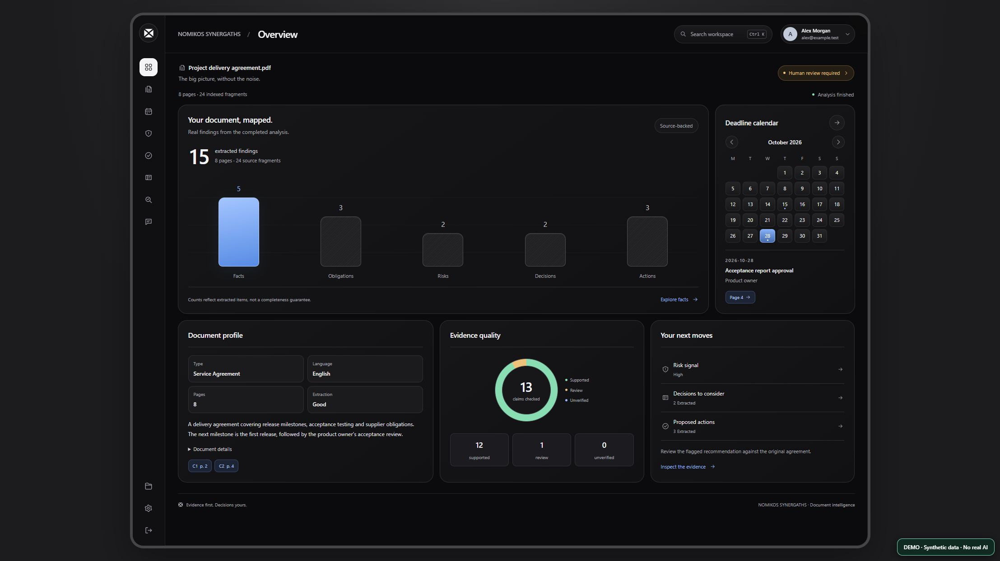
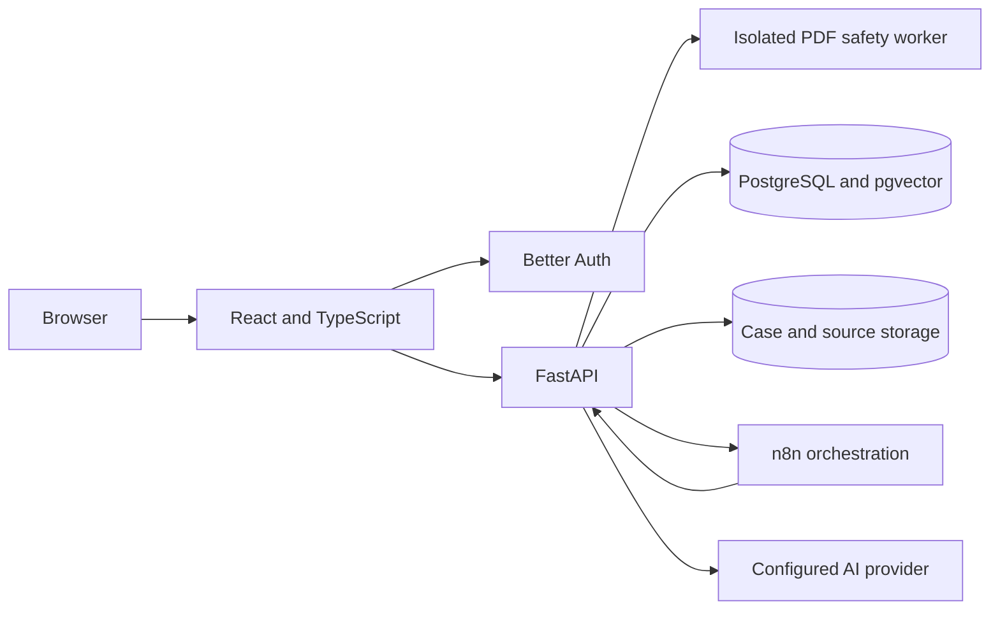

<p align="center"></p>

<p align="center"><strong>Understand the document. Trace the evidence. Keep people in control.</strong><br />PDF analysis · facts and deadlines · risk review · cited answers</p>

<p align="center"><a href="docs/DEMO.md">Interactive demo</a> · <a href="docs/live-demo/README.md">Real application walkthrough</a> · <a href="#the-product">Product</a> · <a href="#architecture">Architecture</a> · <a href="#run-locally">Run locally</a> · <a href="#verification-and-release-status">Verification</a> · <a href="docs/README.el.md">Ελληνικά</a></p>

<p align="center">


</p>

> **Release status:** Development project; not approved for production or real customer documents. AI output can be wrong and must be reviewed against the source. [Security release gate](docs/SECURITY_RELEASE_GATE.md) · [Remaining work](docs/engineering/ROADMAP.md)

## The product

NOMIKOS SYNERGATHS helps a user explore an uploaded PDF, identify facts, obligations, deadlines and risks, and follow citations back to the source. A document becomes an evidence-linked case rather than a detached summary.

- **Overview and document library:** keep the current case and indexed documents together.
- **Facts, deadlines and timeline:** explore extracted obligations and dates.
- **Risks, action plan and decision center:** review proposed next steps and supporting evidence.
- **Ask and evidence:** investigate the source with page-level citations and human review.
- **Background activity:** inspect persisted progress, uncertain results and safe cancellation.

This is an investigative aid, not a substitute for legal advice or professional judgment. Availability and quality depend on document extraction, the configured AI provider and workflow state.

<p align="center"></p>

*The image uses synthetic demo data. The [local application walkthrough](docs/live-demo/README.md) shows two real AI questions on a synthetic PDF, including observed OCR and retrieval limitations. The earlier [isolated mock demo](docs/demo/README.md) is also available.*

## What to inspect in the code

| Engineering concern | Approach | Start here |
| --- | --- | --- |
| Workspace isolation | PostgreSQL/pgvector with restricted roles and row-level security | [Vector store](backend/db/vector_store.py) · [storage evidence](docs/engineering/SECURE_STORAGE.md) |
| Unsafe uploads | Isolated PDF worker, scanning and visual reconstruction; deployment remains a release gate | [PDF worker](security/pdf_worker/README.md) |
| Lost responses and duplicate work | Persisted jobs, stage claims and explicit uncertain-result reconciliation | [Durable analysis](docs/engineering/DURABLE_ANALYSIS.md) |
| Unreliable citations | Source-bound evidence and fail-closed audit paths | [Auditor](backend/services/auditor.py) · [release gate](docs/SECURITY_RELEASE_GATE.md) |
| Identity and sessions | Better Auth and authenticated workspace scope | [Authentication](docs/AUTHENTICATION.md) |
| Recovery | Local encrypted backups and isolated restore drills; offsite recovery is pending | [Retention and recovery](docs/DATA_RETENTION_AND_RECOVERY.md) |

## Architecture



The application submits a document workflow through n8n, persists case stages and checks evidence before presenting results. Relevant excerpts may be sent to the configured AI provider. [Architecture](docs/ARCHITECTURE.md) · [API contracts](docs/API_CONTRACTS.md) · [Project layout](docs/PROJECT_LAYOUT.md)

## Technology

| Area | Technology | Purpose |
| --- | --- | --- |
| Interface | React, TypeScript, Vite | Document workspace and investigation |
| API | Python, FastAPI | Authenticated APIs and document workflows |
| Retrieval | PostgreSQL, pgvector, local embeddings | Workspace-scoped evidence retrieval |
| Identity | Better Auth, PostgreSQL | Accounts and sessions |
| Document safety | Separate PDF worker, ClamAV, OCR | Scan and reconstruct uploaded PDFs |
| Orchestration | n8n | Visible agent and case workflow |
| Quality | Local tests, CI definitions, security checks | Regression and release evidence |

## Interactive demo

Explore the real interface with a synthetic document and two previously recorded AI answers:

```sh
npm --prefix frontend ci
npm --prefix frontend run demo
```

Open http://127.0.0.1:5198 and select the sample document. No real accounts, PDFs or live AI provider calls are involved. The answers were recorded from synthetic excerpts and are not independently verified. See [demo scope and limitations](docs/DEMO.md).

## Run locally

Use Python 3.12, Node.js 22 and Docker with Compose. The full stack requires separate configuration for PostgreSQL, authentication, n8n and the PDF worker; there is no one-command production deployment. Follow the [development setup](docs/DEVELOPMENT.md), [authentication guide](docs/AUTHENTICATION.md), [n8n setup](n8n/README.md) and [PDF worker setup](security/pdf_worker/README.md). Keep secrets in ignored local environment files.

From the repository root, after installing the documented dependencies:

```sh
npm run check
npm test
npm run test:backend
npm run test:integration
```

The integration suite uses a disposable database and requires the documented local PostgreSQL fixture. Model generation requires a configured external provider; no provider charge is needed for the offline checks above.

## Verification and release status

Local results and their exact scope are recorded in [validation](docs/engineering/VALIDATION.md). Earlier isolated checks cover backend regressions, PostgreSQL isolation, browser behavior, auth sessions and PDF processing; they are dated evidence, not a guarantee for a new deployment. The latest complete backend run in this Windows environment encountered a native scikit-learn DLL error during collection. Hosted CI success, signed release artifacts, production security configuration and offsite recovery remain unverified. GitHub Actions are subject to the account's usage budget.

For any release, follow the [release runbook](docs/engineering/RELEASE_RUNBOOK.md). Report security issues privately as described in [SECURITY.md](SECURITY.md). Contributions are welcome under the [contribution guide](CONTRIBUTING.md); licensed under [MIT](LICENSE).
