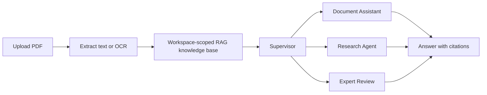
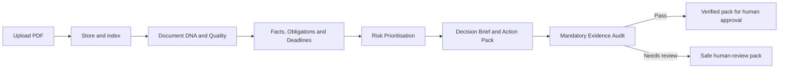

# Documents Made Clear

> Account setup and production security: see [docs/AUTHENTICATION.md](docs/AUTHENTICATION.md).
>
> Repository guide: [architecture](docs/ARCHITECTURE.md), [development workflow](docs/DEVELOPMENT.md) and [contribution rules](CONTRIBUTING.md).
>
> Engineering evidence: [comparison and transferred patterns](docs/engineering/PADEL_COMPARATIVE_AUDIT.md),
> [validation](docs/engineering/VALIDATION.md), [API contracts](docs/API_CONTRACTS.md)
> and [remaining acceptance gates](docs/engineering/ROADMAP.md).

An application for analysing PDF documents with grounded answers and page-level citations. It is designed for compliance, operational, and business documents.

## Product flow



The product has four focused roles:

- **Document Assistant** — answers questions from uploaded PDFs with page citations.
- **Supervisor** — routes a request through the shared document knowledge and produces a grounded final answer.
- **Research Agent** — breaks complex questions into sub-questions and combines the evidence.
- **Expert Review** — three independent risk/compliance perspectives with a moderated recommendation, for high-stakes decisions.

The Hallucination Auditor is an internal quality check that verifies whether the answer is supported by its cited evidence.

## Document Intelligence workflow

For a practical document-operations result, the application also provides a
staged, evidence-first workflow for one uploaded PDF:



Each workflow run creates a server-side, workspace-scoped case file. Facts,
obligations, deadlines, risks, decisions and suggested actions must carry
document citation IDs. The evidence audit fails closed: invalid or unsupported
claims do not reach the actionable final pack. Suggested actions never create
tasks, emails or reminders until a person explicitly approves them.

The browser application starts this workflow automatically after a PDF is
uploaded. The guided interface reflects only the persisted case stages that
n8n has actually completed; it doesn't simulate progress or require the user
to change tabs.

## n8n Agent Orchestrator

The live workflow definition is
`n8n/agent-orchestrator.workflow.json`. It makes the complete operational path
visible in n8n:

`App document-ready webhook -> integration header check -> Start case -> Document DNA -> Facts, Obligations & Deadlines -> Risk Prioritisation -> Decision Brief & Action Pack -> Mandatory Hallucination Auditor -> Evidence Quality Gate -> Finalize`

The lower section contains four separate, on-demand branches for the real
Document Assistant, Supervisor, Research Agent, and Expert Review service.
They are not run merely for presentation: each invokes its own secured backend
endpoint and returns real evidence, routes, or advisor output.

The application sends its server-side `X-N8N-API-Key` header to n8n and the
workflow forwards it to the backend. The backend validates the key and the
workspace on every agent endpoint, so the workflow stores no secret and does
not need node-level access to environment variables. The legacy manual-form
template remains as a reference only; use the application upload flow for the
active, fully configured orchestration.

Start n8n locally:

```powershell
cd n8n
docker compose --env-file .env up -d
```

Then open `http://localhost:5678` and select **Documents Made Clear · Agent Orchestrator**.
It must be published before the application can call its production webhook.

## Local development

From the repository root, after installing the frontend/auth dependencies and
the backend virtualenv:

Follow [first-time setup](docs/DEVELOPMENT.md) for hash-locked dependencies,
dedicated PostgreSQL/pgvector role/migrations and the separate auth/PDF services.

```powershell
npm run check          # source boundaries, links, frontend lint/build, auth types
npm test               # repository/security policy, frontend transport/state, auth
npm run test:backend   # isolated backend tests, no live document store
npm run test:integration # real SQL tests in a newly created disposable database
```

Browser, dependency-audit and operational commands are described in
[testing](docs/TESTING.md) and [operations](docs/OPERATIONS.md). A passing build
does not override the [security release gate](docs/SECURITY_RELEASE_GATE.md).

Backend:

```powershell
cd backend
python -m uvicorn main:app --reload --port 8000
```

Frontend:

```powershell
cd frontend
npm install
npm run dev
```

## Configuration

Copy `backend/.env.example` to `backend/.env` and configure an LLM provider:

```env
ANTHROPIC_API_KEY=
OPENAI_API_KEY=
LLM_PROVIDER=anthropic
N8N_WEBHOOK_API_KEY=
N8N_ORCHESTRATOR_URL=http://localhost:5678/webhook/nexus-agent-orchestrator/case
DOCUMENT_CASE_DB_PATH=./document_cases.db
```

Embeddings run locally. Anthropic/OpenAI credentials are needed only for generation and evaluation calls.

## Tests

```powershell
cd backend
pytest -q

cd ../frontend
npm run build
```

## Tech stack

- FastAPI, LangGraph/LangChain, PostgreSQL/pgvector, BM25, PyMuPDF and isolated Tesseract OCR
- React, TypeScript, Vite, Tailwind CSS
- n8n for upload and delivery automations
