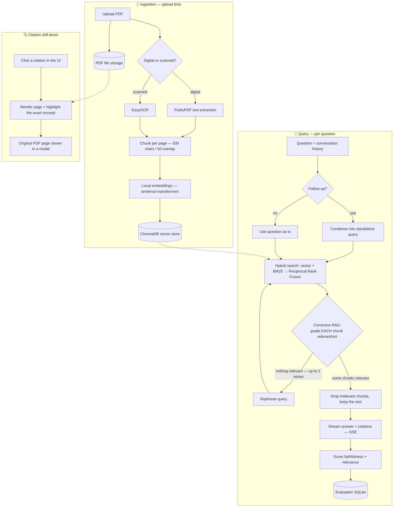
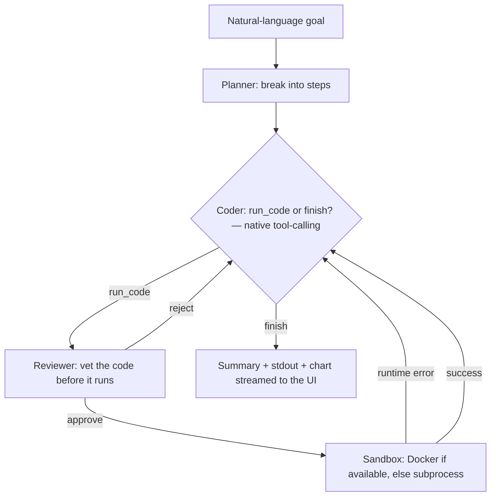
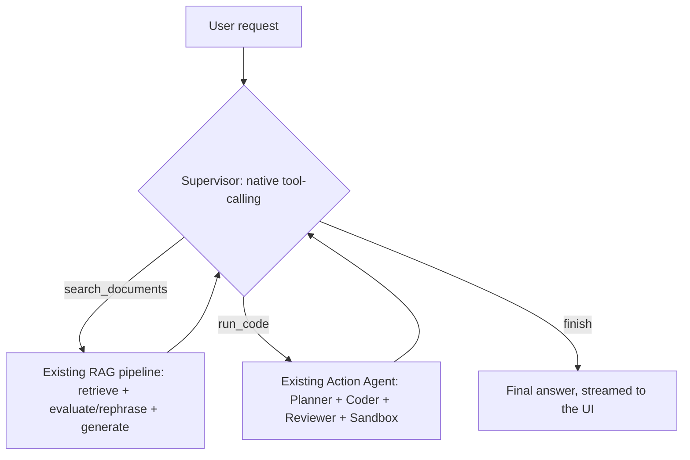
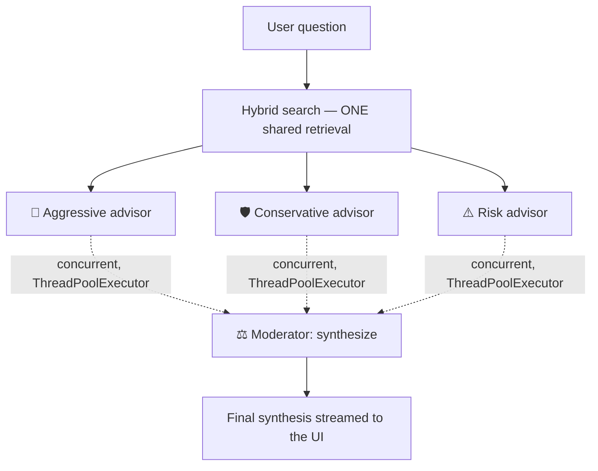
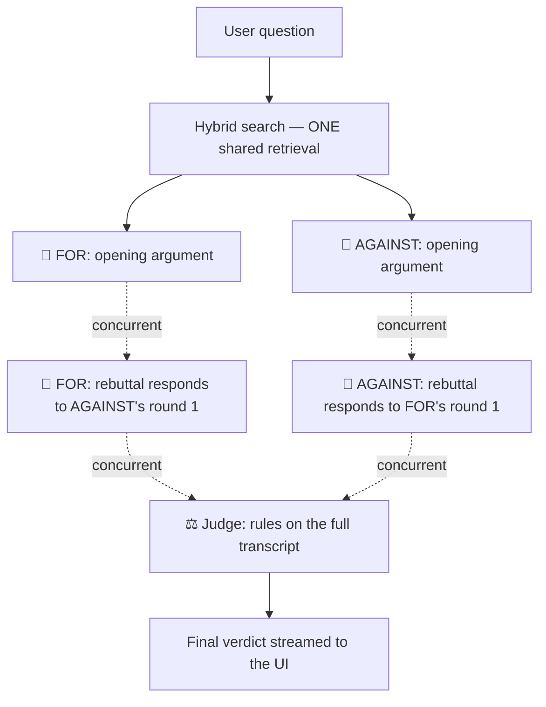
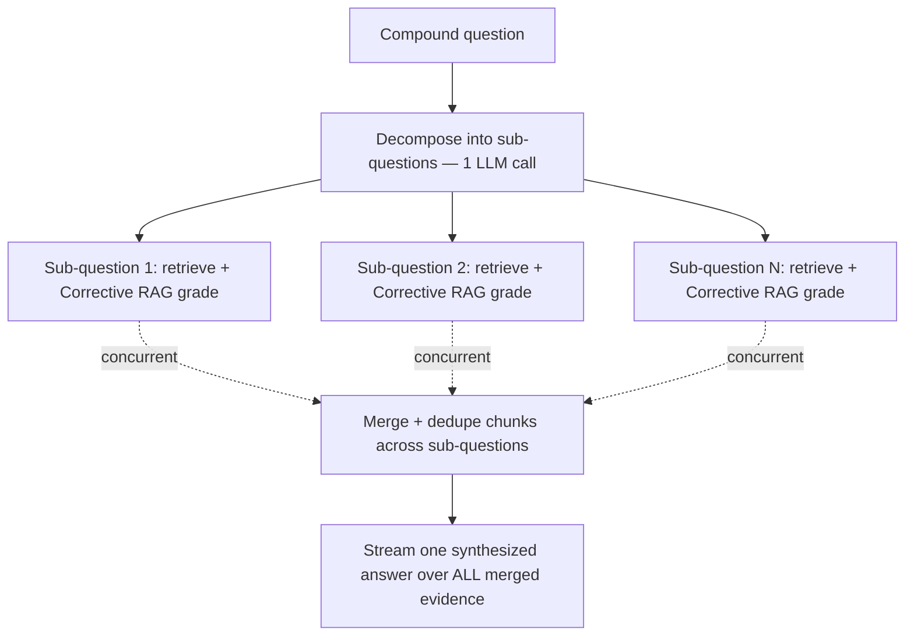

<p align="center">
  
</p>

<p align="center">
  
  
  
  
  
  
  
  
  
  
</p>

<p align="center">
  A full-stack RAG system for tax/compliance documents — upload PDFs, ask questions in
  natural language, get streamed answers grounded strictly in the documents with
  <strong>page-level, click-to-verify citations</strong> — built as a testbed for
  <strong>six genuinely different agent architectures</strong> on one shared retrieval core.
</p>

**🔗 Live demo:** *(deploy following the [runbook below](#deployment) and drop your Render/Vercel URLs here)*

---

## Screenshots & Visuals

*(Paths below are wired up and ready — drop real screenshots into `docs/screenshots/` with these
exact filenames and every section below renders automatically. None exist yet in this checkout;
see the [publishing checklist](#publishing-to-github) before you push.)*

<details open>
<summary><strong>Document Assistant — streaming answers, click-to-verify citations, Hallucination Auditor</strong></summary>
<br>


</details>

<details>
<summary><strong>Action Agent — Planner → Coder → Reviewer trace, sandboxed code execution</strong></summary>
<br>


</details>

<details>
<summary><strong>Supervisor — tool-calling router chaining retrieval + code execution</strong></summary>
<br>


</details>

<details>
<summary><strong>Advisory Panel — 3 concurrent personas + Moderator synthesis</strong></summary>
<br>


</details>

<details>
<summary><strong>Debate Agents — adversarial rounds of rebuttal + Judge verdict</strong></summary>
<br>


</details>

<details>
<summary><strong>Research Agent — multi-hop decomposition + synthesized answer</strong></summary>
<br>


</details>

<details>
<summary><strong>Evaluation & Ops — faithfulness/relevance scores, per-request cost & latency</strong></summary>
<br>


</details>

---

## Table of contents

- [Features](#features)
- [Tech Stack](#tech-stack)
- [Architecture](#architecture)
- [Action Agent](#action-agent)
- [Supervisor](#supervisor)
- [Advisory Panel](#advisory-panel)
- [Debate Agents](#debate-agents)
- [Multi-hop Research Agent](#multi-hop-research-agent)
- [Hallucination Auditor](#hallucination-auditor)
- [Observability](#observability)
- [Quick Start](#quick-start)
- [Testing](#testing)
- [API](#api)
- [Project Structure](#project-structure)
- [Environment Variables](#environment-variables)
- [Deployment](#deployment)
- [Publishing to GitHub](#publishing-to-github)
- [Project Summary](#project-summary)
- [License](#license)

---

## Features

### Core RAG & Retrieval

| | |
|---|---|
| Hybrid search | Vector search (ChromaDB) + BM25 keyword search, merged via Reciprocal Rank Fusion |
| Corrective RAG | Per-chunk relevance grading — irrelevant chunks are filtered before generation ever sees them, not just a batch-level pass/fail |
| Adaptive retry | Up to 2 query rephrase-retries when nothing in a retrieved batch grades relevant |
| Conversational memory | Follow-ups are condensed into standalone queries using prior turns |
| Streaming citations | SSE, token-by-token answers with page-level citations attached on completion |
| Click-to-verify citations | Every citation opens the real PDF page with the cited excerpt highlighted server-side |
| OCR support | EasyOCR fallback for scanned (non-digital-text) PDFs |
| Hallucination Auditor | On-demand, per-sentence supported/unsupported grading of any completed answer |

### Multi-Agent Patterns

| | |
|---|---|
| [Action Agent](#action-agent) | Independent Planner → Coder → Reviewer loop; native LLM tool-calling; Docker-sandboxed code execution with subprocess fallback |
| [Supervisor](#supervisor) | Native tool-calling router that chains document retrieval and code execution on demand |
| [Advisory Panel](#advisory-panel) | 3 personas (aggressive / conservative / risk) run **concurrently** over shared evidence; a Moderator synthesizes |
| [Debate Agents](#debate-agents) | 2 adversarial personas argue opposing positions across rounds of direct rebuttal; a Judge rules |
| [Multi-hop Research Agent](#multi-hop-research-agent) | Decomposes compound questions into sub-questions, retrieves concurrently, synthesizes one answer |

### Observability & Evaluation

| | |
|---|---|
| Correlation IDs | Every request gets an `X-Request-ID`, threaded through logs, traces, and cost accounting |
| Structured logging | JSON log lines, not free text — parseable by any log aggregator, no regex layer needed |
| Cost/token accounting | Every LLM call is priced and attributed back to its originating request, persisted to SQLite |
| Distributed tracing | Real OpenTelemetry spans; zero-cost no-op with no exporter configured, live with one env var |
| Faithfulness/relevance scoring | Every query is scored automatically and tracked on an Evaluation dashboard |

### Frontend UX

| | |
|---|---|
| Dark, gold-accent theme | Custom Tailwind v4 design tokens, Noto Serif display font (full Greek glyph coverage) |
| 6 dedicated views | One tab per agent pattern, plus Evaluation and Ops (Observability) dashboards |
| Animated feedback | Skeleton loaders, fade-in entrances, streaming cursor, count-up stat tiles, mini bar charts |
| PDF viewer modal | Opens the exact cited page with the excerpt highlighted, from any tab |
| Custom rich-text renderer | Dependency-free markdown-lite + citation renderer shared across every agent view |

---

## Tech Stack

| Layer | Technology |
|---|---|
| Backend | Python 3.11, FastAPI 0.139, Pydantic v2, Uvicorn |
| Agents / orchestration | LangGraph 1.2, LangChain-core, native LLM tool-calling (Anthropic + OpenAI) |
| LLMs | Anthropic Claude (`claude-haiku-4-5` default), OpenAI (optional via `LLM_PROVIDER=openai`) |
| Vector store | ChromaDB 1.5 |
| Keyword search | rank-bm25, fused with vector search via Reciprocal Rank Fusion |
| Embeddings | sentence-transformers (`all-MiniLM-L6-v2`), local — no API key, no network call |
| PDF processing | PyMuPDF (digital text + page rendering), EasyOCR (scanned PDFs) |
| Observability | OpenTelemetry SDK 1.43, structured JSON logging, SQLite-backed cost/latency metrics |
| Sandboxed execution | Docker (`--network none`, memory/CPU/pids limits) with an isolated subprocess fallback |
| Auth / isolation | Per-visitor session isolation (no accounts), fail-closed API key for code execution, opt-in API key for everything else, slowapi per-route rate limits |
| Frontend | React 19, TypeScript 6, Vite 5 |
| Styling | Tailwind CSS 4 (CSS-first theming), custom design tokens, no charting/markdown library |
| Testing / CI | pytest — 180 tests, ~90% coverage on `services`/`routers`/`db`; GitHub Actions (backend tests + frontend build) |

---

## Architecture



**Corrective RAG**: the evaluate step (`services/agent.py::_evaluate` /
`_grade_chunks`) doesn't ask one whole-batch question ("can you answer from
these chunks at all?") — it grades *each* retrieved chunk individually, in
one LLM call, and generation only ever sees the chunks graded relevant. A
batch of 5 retrieved chunks where only 2 are actually on-topic used to get
passed to generation in full (noise and all) as long as *something* in the
batch was usable; now the other 3 are filtered out before they ever reach
the model. A rephrase-retry is triggered only when *nothing* in the batch
graded relevant, not merely when the batch didn't unanimously pass — so the
retry loop's behavior is stricter about noise, not about whether to give up.

## Action Agent

A second, independent agent (`backend/services/code_agent.py`,
`backend/services/llm.py::call_with_tools`, `backend/services/sandbox.py`) — no
retrieval, no documents, no ChromaDB. Three roles, each a separate LLM call:

- **Planner** — breaks the goal into 2-4 visible steps up front (`plan_steps`).
- **Coder** — a genuine ReAct agent: at each step it decides, via the LLM
  provider's *native* tool-calling API (not a regex-parsed code fence), whether to
  invoke `run_code` or `finish`. This is the one part of the app where the model
  itself chooses the next action rather than following a fixed graph.
- **Reviewer** — vets every proposed snippet *before* it ever reaches the sandbox
  (`review_code`) and can reject it — feeding a reason back to the Coder — without
  spending a sandbox execution at all. Runtime errors (code the Reviewer approved
  but that still failed) are fed back the same way, so both a proactive review
  *and* a reactive runtime-error loop can trigger self-correction.



Try it: switch to the **⚡ Action Agent** tab in the UI and click one of the sample
goals (e.g. "Compute compound interest on €10,000 at 5% for 10 years and plot the
growth curve") — the plan, every reviewer verdict, every execution, and any error
and fix that followed, all stream live.

**Sandbox**: `services/sandbox.py` tries a real Docker container per execution
first (`--network none`, memory/CPU/pids limits, no inherited host
environment — see `backend/sandbox.Dockerfile` for the one-time build), and
falls back automatically to the original subprocess isolation (fresh temp dir,
secret-stripped environment, wall-clock timeout, a static block-list on
`os`/`subprocess`/`socket`/etc.) when Docker isn't installed or running — no
config needed either way, and the UI shows which backend actually ran. The
subprocess fallback is still demo-grade, not a security boundary, for a real
public deployment without Docker; see [Known limitations](#known-limitations-read-before-deploying).

## Supervisor

A third agent (`backend/services/supervisor.py`) that sits on top of the two
above, orchestrating them rather than duplicating either one's logic. Given a
request, it decides — via the same native tool-calling mechanism the Action
Agent's Coder uses — whether it needs:

- `search_documents` — the existing agentic RAG pipeline, for facts/figures/
  rules that live in the uploaded PDFs.
- `run_code` — the existing multi-agent Action Agent, for real computation,
  simulation, or charts.
- both, chained — e.g. *"find the R&D deduction rate in the PDF, then compute
  how much a company with €50,000 in expenses would save"*. The Supervisor's
  own loop re-sends its running transcript each turn (same pattern as the
  Coder's ReAct loop), so by the time it decides to call `run_code`, the fact
  it just retrieved is already in context — it folds the retrieved number
  directly into the code agent's goal instead of making it re-derive or guess.



No new retrieval or code-execution logic lives in this module — it only
decides *when* to call the two existing subsystems and stitches their outputs
together, which is what makes it a genuine supervisor/router pattern rather
than a third independent pipeline.

Try it: switch to the **🧭 Supervisor** tab and click the sample goal that
chains both ("find the R&D deduction rate... then compute...") against the
sample tax memo PDF — you'll see a `search_documents` step stream its cited
answer, then a `run_code` step open up with its own nested Planner/Coder/
Reviewer trace, before the Supervisor's own final answer appears.

## Advisory Panel

A fourth multi-agent pattern (`backend/services/advisory_panel.py`), and a
deliberately different shape than the two above: the Supervisor is a
*sequential* router that decides which ONE subsystem to call next, and the
Action Agent is a *sequential* Planner → Coder → Reviewer loop. The Advisory
Panel instead runs three differently-instructed advisor personas
**concurrently** (via Python's `ThreadPoolExecutor`, since the LLM SDK calls
are synchronous) over the exact same retrieved chunks — no advisor has more
information than another, so there's no reason to force them through one at
a time:

- **🚀 Επιθετικός Φοροτεχνικός (Aggressive Tax Optimizer)** — argues the most
  aggressive, still-document-grounded interpretation that maximizes benefit.
- **🛡️ Συντηρητικός Υπεύθυνος Συμμόρφωσης (Conservative Compliance Officer)**
  — argues the safest, most clearly compliant interpretation and flags
  anything that would need more documentation.
- **⚠️ Αναλυτής Κινδύνου (Risk Assessor)** — doesn't recommend action at all;
  scores the risks/ambiguities/documentation gaps in the evidence (Low /
  Medium / High).

A fourth agent, the **Moderator**, then reads all three opinions and
synthesizes where they agree, where they disagree, and a final balanced
recommendation — without inventing any new facts beyond what the three
advisors already said.



Every persona still inherits the same document-only grounding rule as the
main RAG system prompt (`services/llm.SYSTEM_PROMPT`) — only the
*interpretive angle* differs, never the evidentiary bar; a panel that let
personas hallucinate more freely than the base system would be a worse
feature, not a better one. This reuses `services/llm.generate_with_system`
(a generalization of `generate_answer` that accepts an arbitrary system
prompt instead of the hardcoded one — `generate_answer` itself now just
delegates to it) rather than duplicating any generation logic.

Try it: switch to the **⚖️ Advisory Panel** tab and click a sample question
against the sample tax memo PDF — the three advisor cards populate in
whatever order they actually finish (not left-to-right), which is the
visual proof they're running in parallel, before the Moderator's synthesis
appears underneath.

## Debate Agents

A fifth multi-agent pattern (`backend/services/debate.py`), and more
adversarial than the Advisory Panel: instead of three independent opinions
that never read each other, two personas argue OPPOSING positions across
`MAX_ROUNDS` (2) rounds of DIRECT rebuttal — each side explicitly reads and
responds to the other's previous argument, the way a real debate works.
Within a single round both sides still run **concurrently** (round *N+1* only
needs round *N*'s opponent argument, never the current one, so there's no
ordering dependency within a round) — the same `ThreadPoolExecutor` pattern
as the Advisory Panel, for the same underlying reason.

- **📢 Εισηγητής Υπέρ (Advocate For)** — argues the most favorable,
  still-document-grounded interpretation.
- **🛑 Εισηγητής Κατά (Advocate Against)** — argues the more cautious,
  still-document-grounded interpretation, directly challenging the other
  side's reasoning round over round.

A **Judge** agent then reads the full transcript (both sides, every round)
and rules on which position is better supported by the evidence, where the
losing side still has valid points, and gives a final balanced recommendation.



Both personas still inherit the same document-only grounding rule as the main
RAG system prompt — only the interpretive angle differs, never the
evidentiary bar. Reuses `services/llm.generate_with_system`, the same
generalized-generation function the Advisory Panel uses.

Try it: switch to the **🥊 Debate Agents** tab and click a sample question —
watch round 1's two opening arguments land in whatever order they finish,
then round 2's rebuttals explicitly quote and respond to the *opposite*
side's round-1 argument, before the Judge's verdict appears.

## Multi-hop Research Agent

A RAG-quality upgrade rather than a new persona (`backend/services/multihop.py`).
The existing agentic pipeline (`services/agent.py`) issues exactly ONE
retrieval per question, with up to 2 rephrase-retries if it comes back empty.
That's fine for atomic questions, but a compound question like *"what's the
R&D deduction rate, and how does it compare to the equipment depreciation
rate?"* packs multiple distinct information needs into one query — a single
embedding of the whole question dilutes each sub-need's signal in vector
search, and BM25 has no way to window over just one clause either.

The Research Agent decomposes the question into standalone sub-questions
FIRST (one LLM call, JSON list output, falls back to treating the question as
atomic if parsing fails or too many sub-questions come back), then runs
retrieval + **Corrective RAG grading** — reusing `services.agent._grade_chunks`
directly, so the exact same per-chunk relevance filtering applies here too —
for EACH sub-question CONCURRENTLY (same `ThreadPoolExecutor` pattern as the
Panel/Debate agents, since no sub-question depends on another's result).
Results are merged and deduped (the same page can legitimately answer more
than one sub-question) before one final synthesized answer streams back.



Try it: switch to the **🔬 Research Agent** tab and click a sample compound
question — the sub-questions list appears first, then each sub-question's
own citations populate as its (concurrent) retrieval finishes, before the
final answer streams, grounded across all of them.

## Hallucination Auditor

A different kind of check than `services/evaluator.py`'s faithfulness score
(`backend/services/auditor.py`). The evaluator asks the LLM for a single
0.0-1.0 number for the whole answer on every query — useful as a
trend/dashboard metric, but silent on WHICH part of the answer to distrust.
The Auditor instead splits an already-generated answer into individual
sentences and grades EACH ONE independently as SUPPORTED or UNSUPPORTED by
its citations, in one LLM call (same "batch, not N calls" principle as
Corrective RAG's `_grade_chunks`).

This runs **on demand**, not automatically on every query — auditing costs
an extra LLM call, and the numeric faithfulness score already runs for free
on every query. A "🔎 Έλεγχος πηγών" button appears under any completed
answer with citations in the **Document Assistant** tab; clicking it grades
every sentence and re-renders the answer with unsupported sentences
underlined in red (hover for the model's stated reason) — a fine-grained
complement to the aggregate score already on the Evaluation dashboard.

Graceful fallback: an unparseable grading response marks every sentence
supported (with a "couldn't verify" reason) rather than making unsupported
claims about the answer without an actual successful grading pass — the same
never-worse-than-the-coarse-fallback philosophy as `_grade_chunks` and
`_decompose`.

## Observability

Answer quality (the Evaluation dashboard, the Hallucination Auditor) is a
different concern from *system* health — "is this app slow, expensive, or
broken right now, and why did this one specific request behave the way it
did?" `backend/services/observability.py` answers the second question with
three pieces, threaded through every request via a FastAPI middleware
(`main.py`):

- **Correlation IDs + structured logging** — every request gets an
  `X-Request-ID` (reused from the incoming header if a caller already set
  one). Every log line is one JSON object (timestamp, level, request_id, +
  context) instead of free text, so it's `jq`-able and ships to any log
  aggregator without a parsing layer in front of it.
- **Per-request cost/token accounting** — every LLM call in the app funnels
  through the single choke point `services/llm.py`, which is instrumented
  once there to report token counts and a computed USD cost (`MODEL_PRICING`)
  for every call. Costs accumulate per-request and persist to SQLite, so
  `GET /observability/summary` and `GET /observability/requests` can answer
  "what is this app costing me, broken down by route" — the Advisory
  Panel/Debate/Research agents fire several LLM calls per request, so their
  cost is expected to dominate. A "📊 Ops" tab in the Document Assistant view
  renders this live.
- **Distributed tracing** — a real OpenTelemetry `TracerProvider`, not a
  hand-rolled substitute. Every HTTP request gets a root span; every LLM call
  gets a child span with model/token/cost attributes. With no exporter
  configured this is a zero-cost no-op (no console spam, no network calls
  with nowhere to go); set `OTEL_EXPORTER_OTLP_ENDPOINT` to point the exact
  same code at a real collector (Jaeger, Honeycomb, Grafana Tempo, ...) with
  no further changes.

One subtlety worth calling out: `concurrent.futures.ThreadPoolExecutor`
(used by the Advisory Panel, Debate Agents, and Multi-hop Research for their
concurrent LLM calls) does **not** copy the calling thread's `contextvars`
into worker threads by default — a plain `executor.submit` would silently
drop the request ID and cost accumulator, so those concurrent calls would
still work but wouldn't be attributed back to the parent request.
`services.observability.submit_with_context` fixes this at every
`ThreadPoolExecutor.submit` call site by running the worker inside a copied
`contextvars.Context`.

LangSmith tracing for the LangGraph agent (`services/agent.py`) is
deliberately **not** wired up as code — LangGraph auto-instruments itself the
moment `LANGCHAIN_TRACING_V2=true` / `LANGCHAIN_API_KEY` are set (see
`.env.example`). That's a genuine zero-code integration, not a gap.

---

## Quick Start

### Backend

```bash
cd backend
python -m venv venv && source venv/bin/activate
pip install -r requirements.txt
cp .env.example .env   # fill in ANTHROPIC_API_KEY (default LLM_PROVIDER=anthropic)
                        # OPENAI_API_KEY only needed if you switch LLM_PROVIDER=openai
uvicorn main:app --reload --port 8010
# -> http://localhost:8010/docs
```

Port 8010 (not the more common 8000) is the default here on purpose — 8000 is
frequently already claimed by something else on a dev machine (another project,
Docker Desktop's port-forwarding for a different container, etc.), and a
same-port collision silently routes your requests to the *other* app instead of
throwing a clear "address already in use" error. If 8010 is also taken, pick any
free port and update `frontend/vite.config.ts`'s proxy target to match.

Health check: `curl http://localhost:8010/health`

### Frontend

```bash
cd frontend
npm install
npm run dev
# -> http://localhost:5173
```

Vite proxies `/api/*` to `http://localhost:8010` in dev (see `vite.config.ts`), so no
`.env` is needed locally. For production, set `VITE_API_BASE_URL` to the deployed
backend URL (see `.env.production.example`).

**Note on Vite version**: this project pins `vite@5` / `@vitejs/plugin-react@4`
deliberately. Vite 8's default Rolldown (Rust) bundler crashed in the sandbox this
was built in — if you hit a similar native-binary crash in your own environment,
this pin is why, and it's safe to try upgrading later.

---

## Testing

```bash
cd backend
pip install -r requirements.txt -r requirements-dev.txt
pytest --cov=services --cov=routers --cov=db --cov-report=term-missing
```

Current local verification:

```text
Backend tests:   180 passed
Frontend build:  passed (tsc -b + vite build, clean)
Frontend audit:  2 known dev-only advisories (esbuild/vite dev-server,
                 moderate + high) — tied to the deliberate vite@5 pin above;
                 does not affect the production build, see Known limitations.
```

~90% coverage on `services`/`routers`/`db`. Every LLM and embedding call
is mocked (no API keys, network calls, or downloaded model weights needed to run
the suite) — this covers ingestion, hybrid retrieval + RRF math, all three
LangGraph agent branches (immediate success, retry-then-succeed, max-iterations
cap), the rephrase-retry loop's SSE status event, the evaluator, the API layer
including auth and rate limiting, both the OpenAI and Anthropic code paths in
`services/llm.py` including native tool-calling via `call_with_tools`
(provider switching is asserted directly, not assumed), the local embeddings
module's lazy-load/caching behavior, PDF page rendering/highlighting
(`services/page_render.py`, `services/pdf_storage.py` — including the path-traversal
guard on stored filenames and graceful fallback when a snippet can't be matched on
the page), the independent Action Agent's full multi-agent loop
(`services/code_agent.py` — Planner JSON parsing/fallback, Reviewer approve/reject
parsing, the Coder's ReAct loop including reviewer-rejection, runtime-error
self-correction, and giving up after the max tool-call budget; `services/sandbox.py`
— the Docker-availability probe and its caching, dispatch to Docker vs. subprocess,
the blocked-import list, timeout handling, correct UTF-8 round-tripping of
non-ASCII code/output, and that neither backend leaks API keys into executed
code's environment), the Supervisor's full routing logic
(`services/supervisor.py` — documents-only, code-only, chained documents-then-code,
finishing immediately without any tool call, and giving up after the max step
budget), Corrective RAG's per-chunk grading (`services/agent.py::_grade_chunks` —
JSON bool-list parsing, the graceful all-relevant fallback on an unparseable or
wrong-length response, filtering irrelevant chunks out of what generation
actually sees, and retrying only when *nothing* graded relevant), and the
Advisory Panel (`services/advisory_panel.py` — all three advisors' events firing
regardless of completion order, the Moderator prompt actually containing all
three opinions, the short-circuit when retrieval returns no chunks at all with
no wasted advisor/moderator calls, and that one advisor raising an exception
doesn't take down the other two or the run), the Debate Agents
(`services/debate.py` — both sides' arguments firing regardless of completion
order, that a round-2 rebuttal responds to the CORRECT opponent argument
specifically (not its own, not the wrong round), the Judge prompt containing
the full transcript, the short-circuit on no chunks, and survival of one side
raising an exception), the Multi-hop Research Agent (`services/multihop.py`
— decomposition JSON parsing/fallback (including the too-many-subquestions
case), per-sub-question Corrective RAG grading and its own unfiltered
fallback, concurrent sub-question retrieval, merging/deduping chunks shared
across sub-questions, the single-sub-question path skipping the concurrency
machinery, and the fallback message when nothing is found anywhere), and the
Hallucination Auditor (`services/auditor.py` — sentence splitting, the
all-unsupported fallback when there are no citations at all, JSON verdict
parsing, and the all-supported graceful fallback on an unparseable or
wrong-length grading response — plus the `/audit/run` endpoint itself).
`services/ocr.py`, the streaming-generator internals, and an actual
Docker container run are intentionally excluded from the suite — the Docker
path's *dispatch logic* (availability probing, caching, falling back cleanly) is
unit tested with a mocked `docker` CLI, but a real container execution needs an
actual Docker daemon and was only exercised via the subprocess fallback path in
this environment; verify the Docker path yourself once you've built the sandbox
image locally (see the Action Agent section above) — the same tests would need a
machine with Docker installed to run for real.

Two cross-test-file isolation bugs were found and fixed while building this out
(see `tests/conftest.py`): `main.py`'s `load_dotenv()` loads the real
`backend/.env` into the process environment the first time `main` is imported,
which — since dotenv doesn't override already-set variables — would otherwise
leak a real `LLM_PROVIDER=anthropic` (and whatever real API key comes with it)
into every later test that assumed the "openai" default; and the sandbox's
Docker-availability cache (a deliberate module-level cache in production, to
avoid probing `docker info` on every single run) would otherwise leak a mocked
"Docker available" result from one test into unrelated later ones. Both are now
reset by autouse fixtures before every test.

CI (`.github/workflows/ci.yml`) runs this suite plus a frontend typecheck + build on
every push/PR once this is pushed to GitHub.

A manual, tab-by-tab QA script for exercising the running app end-to-end (what to type
into each of the 6 views and what to expect back) lives in
[`docs/TESTING.md`](docs/TESTING.md).

---

## API

| Method | Endpoint | Description |
|---|---|---|
| `POST` | `/upload` | Multipart PDF upload → chunked, embedded, indexed |
| `GET` | `/documents` | List uploaded PDFs with chunk counts |
| `GET` | `/documents/{filename}/page` | Render a PDF page as PNG with the cited excerpt highlighted |
| `DELETE` | `/documents/{filename}` | Remove a document, its chunks, and its stored PDF |
| `POST` | `/query` | SSE — core RAG chat (hybrid search + Corrective RAG + streaming citations) |
| `GET` | `/evaluation` | Aggregated faithfulness/relevance scores + last 10 queries |
| `POST` | `/agent/run` | SSE — independent Action Agent (Planner/Coder/Reviewer + sandboxed execution) |
| `POST` | `/supervisor/run` | SSE — tool-calling router chaining retrieval + code execution |
| `POST` | `/panel/run` | SSE — Advisory Panel (3 concurrent personas + Moderator) |
| `POST` | `/debate/run` | SSE — Debate Agents (2 adversarial sides across rounds + Judge) |
| `POST` | `/research/run` | SSE — Multi-hop Research Agent (decompose → concurrent retrieval → synthesize) |
| `POST` | `/audit/run` | Hallucination Auditor — per-sentence supported/unsupported grading |
| `GET` | `/observability/summary` | Aggregated request count, cost, tokens, latency, per-route breakdown |
| `GET` | `/observability/requests` | Recent individual requests with cost/latency/token detail |
| `GET` | `/config` | Public — whether code execution is unlocked for the caller (`{"agent_enabled": bool}`) |

Every route above except `/agent/run`, `/audit/run`, and the observability/evaluation
reads accepts (and the frontend always sends) an `X-Session-ID` header — a random UUID
the frontend generates once per browser (`utils/session.ts`) and persists in
localStorage — so uploads/queries/deletes from one visitor are invisible to every
other visitor. `/agent/run` and `/supervisor/run`'s code-execution path additionally
require `X-API-Key` to match `AGENT_API_KEY` (see [Known limitations](#known-limitations-read-before-deploying)
for the full isolation + auth model).

Interactive docs (Swagger) are available at:

```text
http://localhost:8010/docs
```

<details>
<summary><strong>Full event schemas for every SSE endpoint</strong></summary>

- `POST /upload` — multipart PDF upload. Returns `{filename, chunk_count, method}`.
- `POST /query` — SSE stream. Body: `{question, document_filter?, history?}`, where
  `history` is `[{role: "user"|"assistant", content}, ...]` for prior turns (oldest
  first). Emits `{"type":"token","content":...}` events, then
  `{"type":"done","citations":[...],"eval":{...}}`. History is used to resolve
  follow-ups (a condense step rewrites e.g. "and the second point?" into a standalone
  search query — see `services/agent.py`) and to give the model conversational
  context when generating — it never becomes a source of facts on its own.
- `GET /documents/{filename}/page?page=N&snippet=...` — renders page `N` of the
  original PDF as a PNG with `snippet` highlighted if it can be located on the
  page (falls back to an unhighlighted page image, or a 404 if the PDF was never
  stored / has since been deleted). Powers the clickable-citation feature.
- `POST /agent/run` — SSE stream for the independent, multi-agent Action Agent
  (`services/code_agent.py`). Body: `{goal}`. Emits, in order:
  `{"type":"plan","steps":[...]}` once, then per Coder decision
  `{"type":"code","attempt":n,"code":...}`,
  `{"type":"review","attempt":n,"approved":bool,"feedback":...}`, and on
  approved-but-failing code `{"type":"error","attempt":n,"message":...}` (fed back
  to the Coder for self-correction), finally
  `{"type":"done","success":bool,"stdout":...,"image_base64":...|null,"attempts":n,
  "summary":...,"sandbox_backend":"docker"|"subprocess"}`.
- `POST /supervisor/run` — SSE stream for the Supervisor (`services/supervisor.py`).
  Body: `{question, document_filter?}`. Emits `{"type":"route","tool":
  "search_documents"|"run_code","input":...}` before invoking a sub-agent, then
  either `{"type":"rag_token","content":...}` / `{"type":"rag_done",
  "citations":[...]}` (document search) or `{"type":"action_plan"|"action_code"|
  "action_review"|"action_error",...}` forwarded verbatim from the Action Agent's
  own trace followed by `{"type":"action_done",...}` (code execution) — possibly
  both, in sequence, for a chained request — finally
  `{"type":"done","summary":...}`.
- `POST /panel/run` — SSE stream for the Advisory Panel (`services/advisory_panel.py`).
  Body: `{question, document_filter?}`. Emits `{"type":"citations","citations":[...]}`
  once, then `{"type":"advisor","id":...,"label":...,"emoji":...,"answer":...}` once
  per advisor **in completion order** (the three run concurrently, so this is not a
  fixed sequence), finally `{"type":"done","moderator_summary":...}`.
- `POST /debate/run` — SSE stream for the Debate Agents (`services/debate.py`).
  Body: `{question, document_filter?}`. Emits `{"type":"citations","citations":[...]}`
  once, then `{"type":"argument","side":"for"|"against","round":n,"label":...,
  "emoji":...,"text":...}` once per side per round (completion order within a round,
  not a fixed sequence), finally `{"type":"verdict","summary":...}`.
- `POST /research/run` — SSE stream for the Multi-hop Research Agent
  (`services/multihop.py`). Body: `{question, document_filter?, history?}`. Emits
  `{"type":"subquestions","subquestions":[...]}` once, then
  `{"type":"subretrieval","sub_question":...,"citations":[...]}` once per
  sub-question (completion order, not a fixed sequence), then
  `{"type":"token","content":...}` as the final synthesized answer streams,
  finally `{"type":"done","citations":[...]}`.
- `POST /audit/run` — plain JSON (non-streaming) endpoint for the Hallucination
  Auditor (`services/auditor.py`). Body: `{answer, citations: [{filename, page,
  text}, ...]}`. Returns `{"sentences": [{"text":...,"supported":bool,
  "reason":...}, ...]}`, one entry per sentence of `answer`, in order.

</details>

---

## Project Structure

```text
document-rag-assistant/
├── .github/workflows/ci.yml
├── docs/
│   ├── banner.svg
│   ├── TESTING.md               # manual, tab-by-tab QA script
│   └── screenshots/            # drop real PNGs here — see Screenshots section
├── backend/
│   ├── db/
│   │   └── chroma_client.py
│   ├── routers/
│   │   ├── upload.py, documents.py, query.py, evaluation.py
│   │   ├── agent_action.py, supervisor.py
│   │   ├── advisory_panel.py, debate.py, research.py
│   │   ├── audit.py, observability.py
│   ├── services/
│   │   ├── agent.py, retrieval.py, ingestion.py, ocr.py, embeddings.py
│   │   ├── llm.py, evaluator.py, auditor.py, security.py, session_scope.py
│   │   ├── code_agent.py, sandbox.py                    # Action Agent
│   │   ├── supervisor.py                                # Supervisor
│   │   ├── advisory_panel.py, debate.py, multihop.py     # Panel / Debate / Research
│   │   ├── observability.py                              # Ops
│   │   └── page_render.py, pdf_storage.py                # citation drill-down
│   ├── tests/                  # 180 tests across 18 files, see Testing
│   ├── sandbox.Dockerfile       # Action Agent's isolated execution image
│   ├── render.yaml
│   ├── requirements.txt
│   └── .env.example
├── frontend/
│   └── src/
│       ├── api/client.ts
│       ├── components/
│       │   ├── ChatInterface.tsx, UploadZone.tsx, DocumentList.tsx
│       │   ├── CitationsPanel.tsx, PdfPageModal.tsx
│       │   ├── ActionAgent.tsx, Supervisor.tsx, AgentKeyUnlock.tsx
│       │   ├── AdvisoryPanel.tsx, DebateAgents.tsx, ResearchAgent.tsx
│       │   ├── EvalDashboard.tsx, ObservabilityDashboard.tsx
│       │   └── CountUp.tsx, MiniBarChart.tsx             # shared dashboard primitives
│       ├── utils/richText.tsx, session.ts   # rich-text renderer, per-visitor session ID
│       └── App.tsx
└── README.md
```

---

## Environment Variables

### Backend (`backend/.env`)

```env
ANTHROPIC_API_KEY=sk-ant-...        # required (default LLM_PROVIDER)
OPENAI_API_KEY=                     # only if LLM_PROVIDER=openai
LLM_PROVIDER=anthropic
EMBEDDING_MODEL=all-MiniLM-L6-v2    # local, no key needed
CHROMA_PERSIST_DIR=./chroma_db
CHUNK_SIZE=500
CHUNK_OVERLAP=50
MAX_CHUNKS_PER_QUERY=5
ALLOWED_ORIGINS=*                   # lock to your deployed frontend URL in production
API_KEY=                            # optional — set to require X-API-Key on every route
AGENT_API_KEY=                      # gates ONLY code execution; falls back to API_KEY if blank;
                                     # fails CLOSED (refuses) if both are blank — see Known limitations
MAX_UPLOAD_SIZE_MB=20                # hard cap on a single uploaded PDF, in MB
RATE_LIMIT_QUERY=20/minute
RATE_LIMIT_UPLOAD=10/minute
RATE_LIMIT_AGENT=10/minute
RATE_LIMIT_SUPERVISOR=5/minute
RATE_LIMIT_PANEL=5/minute
RATE_LIMIT_DEBATE=5/minute
RATE_LIMIT_RESEARCH=8/minute
RATE_LIMIT_AUDIT=15/minute
LOG_LEVEL=INFO
```

Optional (commented out in `.env.example` with inline explanations): `PDF_STORAGE_DIR`,
`AGENT_SANDBOX_TIMEOUT`, `AGENT_SANDBOX_IMAGE`, `OBSERVABILITY_DB_PATH`,
`OTEL_EXPORTER_OTLP_ENDPOINT`, `OTEL_CONSOLE_EXPORT`, `LANGCHAIN_TRACING_V2` +
`LANGCHAIN_API_KEY` (zero-code LangSmith tracing for the LangGraph agent).

### Frontend (`frontend/.env.production` — dev needs none, Vite proxies locally)

```env
VITE_API_BASE_URL=https://your-backend.onrender.com
VITE_API_KEY=                       # only if the backend's API_KEY is set
```

No env var is needed for session isolation — `utils/session.ts` generates and persists
a random per-browser ID at runtime. A visitor can also unlock code execution without
any frontend build/env change at all: entering the `AGENT_API_KEY` value in the Action
Agent or Supervisor tab's "Unlock" field (`components/AgentKeyUnlock.tsx`) verifies it
against `GET /config` and stores it in that browser's localStorage.

---

## Deployment

Goes live in about 10 minutes, in this order (backend first, since the
frontend needs its URL):

### 1. Push to GitHub

See [Publishing to GitHub](#publishing-to-github) below if you haven't yet.

### 2. Backend -> Render (~5 min)

1. [render.com](https://render.com) -> **New** -> **Blueprint** -> connect this repo.
   Render auto-detects `backend/render.yaml` and proposes the service.
2. Before clicking Deploy, set these **secret** env vars in the Render dashboard
   (`render.yaml` marks them `sync: false`, so they're not committed to git):
   - `ANTHROPIC_API_KEY` — required (default provider)
   - `OPENAI_API_KEY` — only if you plan to switch `LLM_PROVIDER=openai`
   - `API_KEY` — optional; set this to lock down every route except `/health`/`/config`
     with an `X-API-Key` header
   - `AGENT_API_KEY` — recommended for a public deploy; keep this set (and `API_KEY`
     unset) to get the intended posture for a public demo: everything except code
     execution open to anonymous visitors, code execution restricted to whoever you
     give this key to (see [Known limitations](#known-limitations-read-before-deploying))
3. Bump `plan: free` to `starter` (or higher) in `render.yaml` before deploying —
   the free tier's 512MB RAM and lack of a persistent disk break OCR, local
   embeddings, and citation drill-down after restarts (see
   [Known limitations](#known-limitations-read-before-deploying) for specifics).
4. Deploy. Once live, copy the service URL (`https://<name>.onrender.com`) —
   you'll need it in step 3.
5. Sanity check: `curl https://<name>.onrender.com/health` should return `{"status":"ok"}`.

### 3. Frontend -> Vercel (~3 min)

1. [vercel.com](https://vercel.com) -> **Add New** -> **Project** -> import this repo,
   set **Root Directory** to `frontend/` (Vercel auto-detects Vite via `vercel.json`).
2. Set env vars in the Vercel dashboard:
   - `VITE_API_BASE_URL` = the Render URL from step 2.4
   - `VITE_API_KEY` = the same value as the backend's `API_KEY`, only if you set one
3. Deploy. Copy the resulting URL (`https://<project>.vercel.app`).

### 4. Close the loop

Go back to the Render dashboard and set `ALLOWED_ORIGINS` to the Vercel URL from
step 3.3 (CORS defaults to `*`, which works but is wide open — worth tightening
once you have a real frontend URL). Redeploy the backend for it to take effect.

Then drop both URLs into the **Live demo** line at the top of this README.

### Known limitations (read before deploying)

- **Render free tier has no persistent disk.** `render.yaml` requests a 1GB disk,
  which requires a paid plan. Without it, ChromaDB's data, the evaluation SQLite
  file, and the stored PDFs (`PDF_STORAGE_DIR`, used to render citation page
  previews) are all wiped on every restart/redeploy/sleep cycle — citation
  drill-down will 404 for documents uploaded before the last restart.
- **EasyOCR and sentence-transformers both need more RAM than Render's free 512MB
  tier gives you** (both are PyTorch-based). Scanned-PDF uploads and possibly even
  routine embedding calls will likely fail or time out on the free tier — either
  upgrade the plan, or swap in lighter alternatives (Tesseract for OCR; a smaller
  embedding model, or fall back to `LLM_PROVIDER=openai`'s embeddings) if you need
  to stay free.
- **Session isolation is on by default, with no configuration.** Every browser gets a
  random UUID (`utils/session.ts`), sent as `X-Session-ID` on every document-related
  request; the backend stamps it onto every chunk at ingestion and filters every
  read/list/delete by it (`services/session_scope.py::where_clause`). Two anonymous
  visitors sharing the same public URL never see, list, or can delete each other's
  uploads — this needed no `API_KEY` and no accounts. It's an anonymity boundary, not
  a cryptographic one, though: the session ID is a bearer identifier, not a secret
  credential, so anyone who somehow obtained another visitor's ID (e.g. a leaked log
  line) could act as them. A 122-bit random UUID isn't guessable, but it also isn't a
  password — don't extend this scheme to anything more sensitive than a demo's
  disposable document set.
- **Code execution fails closed; everything else is opt-in.** `AGENT_API_KEY` gates
  the Action Agent and the Supervisor's `run_code` tool specifically
  (`services/security.py::require_agent_api_key`) and is the *opposite* default from
  the general `API_KEY`: leave it unset and code execution refuses outright rather
  than silently running arbitrary LLM-generated code for anonymous visitors. Set
  `AGENT_API_KEY` to unlock it for whoever holds that key (via the in-app "Unlock"
  field — no redeploy needed), or set the general `API_KEY` too if you want the
  RAG features behind a key as well (see [Environment Variables](#environment-variables)).
  Rate limits (`RATE_LIMIT_QUERY`, `RATE_LIMIT_UPLOAD`, etc.) are on by default
  regardless of whether either key is configured.
- **Rate limiting needs `--proxy-headers` behind Render's edge proxy.** `render.yaml`'s
  `startCommand` passes `--proxy-headers --forwarded-allow-ips='*'` to uvicorn — without
  it, slowapi's per-IP limiter reads Render's proxy IP instead of the visitor's real one
  via `X-Forwarded-For`, and every visitor silently shares one rate-limit bucket instead
  of getting their own. If you deploy behind a different reverse proxy, confirm it
  forwards `X-Forwarded-For` and that uvicorn is told to trust it.
- **Uploads are capped at `MAX_UPLOAD_SIZE_MB` (20MB default),** enforced in
  `routers/upload.py` before the file is written to disk or handed to PyMuPDF/OCR —
  a basic guard against a visitor exhausting disk/CPU with oversized files.
- **Self-evaluation bias**: faithfulness/relevance scores use the same provider/model
  configured for generation (`LLM_PROVIDER`), which tends to rate itself favorably.
  Treat the eval dashboard as a directional signal, not a rigorous benchmark.
- **Switching embedding models breaks existing data.** The vector dimension is baked
  into whatever's already in ChromaDB — if you ever change `EMBEDDING_MODEL` (or move
  between local embeddings and OpenAI's), delete `chroma_db` and re-upload, or queries
  will fail with a dimension-mismatch error.
- **The Action Agent's isolation depends on whether Docker is available.** With
  Docker installed and the sandbox image built (`docker build -t rag-agent-sandbox
  -f backend/sandbox.Dockerfile backend/`), every execution runs in a real
  container (`--network none`, memory/CPU/pids limits, no inherited host
  environment) — a genuine isolation boundary. Without Docker, it silently falls
  back to the original subprocess sandbox (fresh temp dir, secret-stripped
  environment, timeout, static import block-list), which is demo-grade, not a
  security boundary — a determined adversary running in the same OS as the
  backend process is not truly contained. Check which backend is active via the
  `sandbox_backend` field the UI displays after each run. This risk is now scoped to
  whoever holds `AGENT_API_KEY` rather than to the general public (see the fail-closed
  gating bullet above) — but if you do hand that key out, treat the sandbox backend
  they'll get as part of that decision, not an afterthought — see `backend/services/sandbox.py`.
- **Render's free tier has no Docker-in-Docker support**, so the Action Agent will
  use the subprocess fallback there regardless of the Dockerfile — the Docker path
  is meant for local dev or a deployment target that supports it (e.g. a VM with
  Docker installed, or a platform with sandboxed-execution support built in).
- **The Advisory Panel fires 4 LLM calls per request** (3 advisors concurrently,
  then 1 moderator) — the highest per-request LLM cost in the app alongside the
  Supervisor's RAG path. `RATE_LIMIT_PANEL` defaults to 5/minute for the same reason
  `RATE_LIMIT_SUPERVISOR` does. This route is meant to stay open to the public in the
  recommended deployment (only code execution is key-gated), so its rate limit — not
  `API_KEY` — is the intended cost-control lever; tighten `RATE_LIMIT_PANEL` further
  if LLM spend needs a harder ceiling.
- **The Debate Agents fire 5 LLM calls per request** (2 rounds x 2 sides, plus 1
  judge) — same cost tier as the Advisory Panel, so `RATE_LIMIT_DEBATE` also
  defaults to 5/minute.
- **The Research Agent's cost scales with how compound the question is** —
  1 decomposition call, up to `MAX_SUBQUESTIONS` (4) grading calls, plus 1 final
  synthesis — heavier than a plain `/query` but lighter than the Panel/Debate/
  Supervisor's fixed multi-call cost, hence `RATE_LIMIT_RESEARCH` defaulting to
  8/minute (between `RATE_LIMIT_QUERY`'s 20/minute and the heavier agents' 5/minute).
- **The Hallucination Auditor is comparatively cheap** — one LLM call per
  audited answer, run only when the user clicks "🔎 Έλεγχος πηγών" rather than
  on every query — so `RATE_LIMIT_AUDIT` defaults looser, at 15/minute.

---

## Publishing to GitHub

Do not commit:

```text
backend/.env
backend/venv/
backend/__pycache__/
backend/chroma_db/
backend/evaluation.db
backend/observability.db
backend/storage/
frontend/node_modules/
frontend/dist/
frontend/.env
frontend/.env.production
```

All of the above are already covered by `.gitignore`. `backend/.env.example` and
`frontend/.env.production.example` are the only env files meant to be committed —
both contain placeholders only, never real keys.

Publish (this repo already has local history — first push just needs a remote):

```bash
git add .
git status --short          # sanity-check what's about to be committed
git commit -m "Add multi-agent layer, observability, and UI polish"
git remote add origin https://github.com/Stelios-developer/document-rag-assistant.git
git branch -M main
git push -u origin main
```

Recommended repository topics:

```text
fastapi, react, typescript, langgraph, chromadb, rag,
retrieval-augmented-generation, multi-agent, llm, anthropic-claude,
tax-technology, observability, opentelemetry
```

---

## Project Summary

```text
A full-stack RAG system for tax/compliance documents — FastAPI, LangGraph, ChromaDB,
hybrid vector+BM25 retrieval, Corrective RAG per-chunk grading, and multi-hop query
decomposition — used as a testbed for six genuinely different agent architectures on
one shared retrieval core: a self-correcting, tool-calling code agent; a
supervisor/router that chains retrieval and code execution; a concurrent
multi-persona advisory panel; an adversarial debate-and-judge pipeline; and
multi-hop research decomposition. Production-grade concerns are first-class, not an
afterthought: correlation IDs, structured JSON logging, per-request LLM cost/token
accounting, OpenTelemetry tracing, per-visitor session isolation with a fail-closed
key gate on code execution, per-route rate limiting, and a 180-test suite with ~90%
coverage.
```

---

## License

MIT © [Stelios](https://github.com/Stelios-developer)

*(assumed from context — confirm this is your real GitHub username before pushing;
a matching `LICENSE` file has been added to the repo root)*
